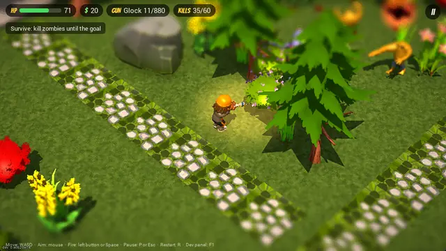
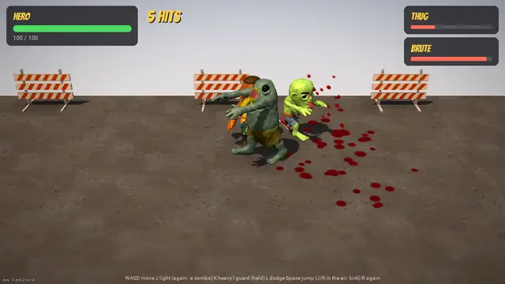
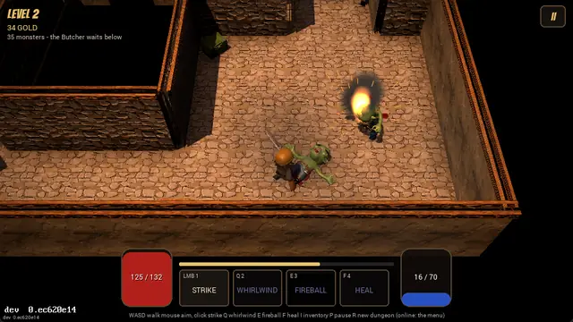
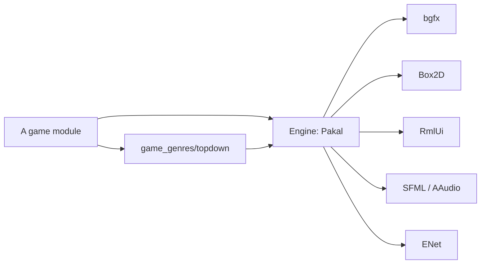

# Pakal Engine

Pakal is a C++20 game engine for 2D and 3D games on Windows, Android and Linux. It has a modern renderer built for real
phones, two ways to write a game's simulation, ready-made pieces for whole genres, network play, and tools that people
and AI coding agents can both drive.

Games are modules: a DLL that the player loads on the desktop, or one library on Android. A game uses the engine's
abstractions (graphics, physics, input, sound, interface) and never the libraries behind them, so the backends can change
under it.

  
  
  

A town from the level builder, the brawler and the dungeon, each playing itself. Made with
the free CC0 model packs by <a href="https://quaternius.com">Quaternius</a>, who is not involved with Pakal.

## What it can do

### Rendering
Rendering goes through [bgfx](https://github.com/bkaradzic/bgfx): Direct3D 11 on Windows, OpenGL ES 3 on Android, and
OpenGL or Vulkan on Linux.

- **Models:** static and skinned glTF and Collada models (Assimp), with metal-rough PBR materials. Repeated models are
  drawn instanced. A character can be assembled from parts (a head, a torso, legs) into one skinned model, drawn in one
  draw.
- **Light:**
  - a sun with shadows fitted to the camera, with simplified shadow casters; a tree can cast through a few quads (a
    shadow proxy) instead of its thousands of leaf cards;
  - baked lightmaps, and a baked ambient light volume;
  - soft cloud shadows drifting over the ground.
- **Post-processing:** screen-space ambient occlusion (optionally depth-aware, so thin geometry does not darken the
  background), bloom, FXAA, color grading, tilt-shift blur and fades. Optional 4x MSAA with alpha-to-coverage for
  leaves and fences.
- **Vegetation:** grass made on the GPU (solid blades by tiles, with density and height maps, clumps, wind and the sun's
  shadow); ground cover, one model drawn at thousands of places in one instanced draw; trees' leaf cards thinned with
  distance.
- **Materials:** water with depth colors, foam and caustics; wind in the foliage. Models can fade, dither, or be cut
  away when they stand between the camera and the player.
- **2D and effects:** sprites, a 2D camera, and particles, in the same frame as 3D.
- **Upscaling:** FSR 1 for scenes drawn below the screen's resolution.

### Built for phones
- **Quality levels:** five of them (minimum to extreme) set shadow maps, post-process samples and the render height.
  The engine picks one per device, and a game can redefine each level from its data, with no rebuild.
- **The governor:** it watches the frame rate and steps the picture down when a phone cannot hold it, then back up when
  it can. First it steps from 60 to 30 fps, then the render scale. It knows about heat as well.
- **Android packaging:** textures are compressed to ASTC with mipmaps. One script builds the APK, or the App Bundle a
  store takes. A game's assets can be sealed into one pack that only the game, with its key, reads; the key is never
  passed on a command line.

### Simulation and gameplay
- **Two models for a game's world:**
  - `SimWorld`: synchronous components in fixed steps, for deterministic games and servers.
  - The asynchronous entity-component model: components with tasks, for presentation.
- **Genres:** `game_genres/topdown` holds what top-down action games share: actors, the level runtime, damage, spawns,
  pickups and doors, with its views kept apart from its simulation. It comes with kits:
  - **shooter:** guns, reloads and fire cycles;
  - **brawler:** moves as data, combos, guards, launches and dodges;
  - **action RPG:** resources, levels and attributes, equipment, abilities and loot.
- **Quests:** `game_genres/quests`, for a game of any genre: quests as data, checked at load and in CI, a state machine
  per quest in the fixed step, one arbiter for the marker and the objective line, saves that survive damaged data, uses
  and quest items, a development panel and MCP tools to read and move a stuck quest, and a route runner that plays
  every quest.
- **Scripting:** Lua for missions and events. An error names the script file it comes from.
- **Physics and AI:** Box2D for 2D physics (static shapes from any simple polygon, concave ones included), character
  controllers, ray casts, a navigation grid built in blocks and reused while its level is unchanged, and an enemy
  controller.

### Interface, sound and input
- **Interface:** [RmlUi](https://github.com/mikke89/RmlUi). Screens are HTML/CSS-like documents bound to data models, so
  text, colors and layout live in files, not in code.
- **Sound:** sound effects positioned in 3D, and OGG music with crossfades and loops. SFML is used on the desktop and
  AAudio on Android. The sound pauses with the app.
- **Input:** keyboard, mouse and gamepads on the desktop; two virtual sticks and touches on phones.

### Network play
One server runs the simulation, and each player's game sends its input and draws what the server's snapshots show
(ENet). Games on the same Wi-Fi find each other without typing an address. The server can run headless, with bots.

### Tools
- **Level editor:** gizmos, an inspector, prefabs, undo, and Play to test the level inside it.
  Run it with `PakalPlayer <module> --edit <level>`.
- **`pakal-level`:** edits a level from the command line, with the same operations and the same undo history as the
  editor. A script or an agent can change a level step by step, even while the game runs.
- **Level builder:** turns a short brief ("a small town with a park and two missions") into playable levels made from
  free CC0 model packs. It has generators for streets, lots, parks and buildings, plus placement rules and missions.
- **MCP server:** a running game, desktop or phone, can be measured and tuned by tools: frame rate, GPU timings per
  pass, quality settings, a fixed camera, screenshots. It answers only local requests that carry its token, never a
  web page's, and a release build does not start it.
- **Profiling and telemetry:** per-pass timings, records written to a file, and a profile of how each run went.

## Examples

| Example | What it shows |
|---|---|
| `examples/zombies_module` | A top-down shooter on the TopDown genre, with Lua missions, waves, weapons and destructible props. Its Downtown level is built from free packs. Windows and Android. |
| `examples/brawler_proto` | A beat 'em up on the brawler kit. |
| `examples/dungeon_proto` | A dungeon crawler on the action RPG kit, with network play and a headless server. |
| `examples/engine_feature_lab` | 2D sprites, a camera and generated sounds, with no assets: the first program to run. |
| `examples/mesh_viewer`, `examples/audio_demo`, `examples/basic_example` | Small samples of one part each. |

The 3D examples use free CC0 model packs that are not stored in Git. One script puts them in place and another exports
the models from them ([docs/QUICKSTART.md](docs/QUICKSTART.md)); the brawler, the dungeon and the Zombies example's
Downtown then run from a fresh clone. The Zombies levels use free rules written for Pakal; with a level converted from an
older game (not free, not included) they take its rules, sounds and shot effects instead.
`engine_feature_lab`, `audio_demo` and `basic_example` run without any assets.

## How it is built

| Layer | Where | What it knows |
|---|---|---|
| Engine | `source/` | No game. Graphics, physics, sound, input, interface, resources, the simulation clock. |
| Genres | `game_genres/` | What one kind of game shares: its simulation, plus its views kept apart. |
| Games | `examples/` | Their own rules, data, scripts, menus and HUD. |

Dependencies only go down. A server, a bot or a test can link a genre's simulation without any graphics. More in
[docs/ARCHITECTURE.md](docs/ARCHITECTURE.md).

## Platforms

| Platform | Graphics | Status |
|---|---|---|
| Windows 10/11 | Direct3D 11 (others through `PAKAL_BGFX_RENDERER`) | Built and tested by CI |
| Linux (Ubuntu 24.04) | OpenGL / Vulkan | Built and tested by CI |
| Android 8.0+, arm64 | OpenGL ES 3 | Built with `android/build_apk.py` |

## Get started

[docs/QUICKSTART.md](docs/QUICKSTART.md) goes from an empty folder to the engine running. The full build guide is
[docs/BUILDING.md](docs/BUILDING.md), and Android is in [docs/ANDROID.md](docs/ANDROID.md). Coding agents read
[AGENTS.md](AGENTS.md). A new game in a repository of its own, with the engine as a submodule:
[AGENTS-NEWPROJECT.md](AGENTS-NEWPROJECT.md) (steps for agents) and [docs/GAME_REPOSITORY.md](docs/GAME_REPOSITORY.md).

## Documentation

[docs/README.md](docs/README.md) lists every page. The main ones:
- **The engine:** [ARCHITECTURE.md](docs/ARCHITECTURE.md), [SUBSYSTEMS.md](docs/SUBSYSTEMS.md),
  [BGFX_BACKEND.md](docs/BGFX_BACKEND.md).
- **Genres and examples:** [TOPDOWN_MODULE.md](docs/TOPDOWN_MODULE.md), [QUESTS.md](docs/QUESTS.md), [ZOMBIES_MODULE.md](docs/ZOMBIES_MODULE.md).
- **Levels:** [LEVEL_BUILDER.md](docs/LEVEL_BUILDER.md), [LEVEL_EDITOR.md](docs/LEVEL_EDITOR.md),
  [EDITOR.md](docs/EDITOR.md).
- **Platforms and performance:** [ANDROID.md](docs/ANDROID.md), [PROFILING.md](docs/PROFILING.md),
  [NETWORK.md](docs/NETWORK.md), [TELEMETRY.md](docs/TELEMETRY.md).

## License

MIT. See [LICENSE](LICENSE). The submodules and libraries keep their own licenses.
