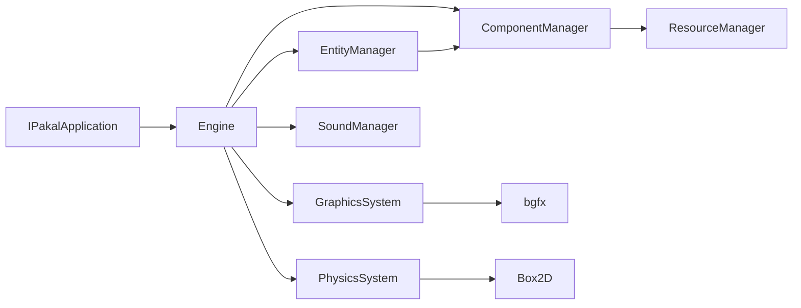

# Pakal Engine architecture

Summary

Pakal is a modular engine written in C++, organized in subsystems (Systems) that implement lifecycle hooks (initialize, update, terminate) and are registered in the central `Engine` class. The engine has two entity-component models (AsyncEntity/AsyncComponent and SyncEntity/SyncComponent, below), and lets you swap subsystem implementations (for example, different GraphicsSystem or PhysicsSystem) through configurable allocators in `Engine::Settings`.

High-level diagram

Execution flow

1. Configuration: create `Engine::Settings`, choose allocators (graphics, physics, sound), and options (threads, max_fps).
2. Initialization: `Engine` initializes managers (ResourceManager, InputManager), creates subsystems and calls `initialize()` (each System can create asynchronous tasks).
3. Main loop: `Engine::run()` runs the loop, updates threadless systems and processes window events. `GraphicsSystem` and `PhysicsSystem` usually run inside the main loop or in threads, depending on configuration.
4. Termination: `Engine` calls `terminate()` on each system and manager to clean up resources.

Key responsibilities

- Engine: orchestration, lifecycle, registration of systems and managers.
- GraphicsSystem: rendering, UI, batchers, materials.
- PhysicsSystem: physics simulation, integration with components.
- ComponentManager / EntityManager: creation and management of the asynchronous entities and their components.
- ResourceManager: loading and management of resources (meshes, textures, sounds).
- AssetCache (`source/AssetCache.h`): assets loaded in the background and shared by handle. `load<T>(path)` gives an
  `AssetHandle` at once (a `shared_ptr` to the asset's slot: loading, ready, failed); the cache keeps a `weak_ptr`, so a
  file loads once while someone holds it. `T::decode` runs on its workers, `T::upload` (GPU resources) on the thread that
  calls `pump()`. `MeshComponent3D_Bgfx` is one such asset (`decode()` / `upload()`; instances `share_from()` it); the
  textures of models decoding at once are decoded once and shared. For both entity models: the simulation's own data
  must be complete before its first step, its views take their models when ready.

Entities: two models

| | AsyncEntity / AsyncComponent | SyncEntity / SyncComponent |
|---|---|---|
| Where | `source/AsyncEntity.h`, `AsyncComponent.h` (EntityManager, ComponentManager) | `source/SyncEntity.h`, `SimWorld.h` |
| Components | Made by the systems (a sprite, a body, a sound) and set up asynchronously (tasks) | Made by the game; any game logic |
| Update | Each system updates its own, on its thread, at its rate | `SimWorld` steps them in order, once per fixed step, on one thread |
| Use it for | Scenery and objects loaded from data (prefabs), what is mostly content; games that need no determinism | A game's simulation: the same seed and input give the same game (replays, bots, networking) |
| Used by | ContraGame, the feature lab, the scene loader | The TopDown module (its `Actor` is a `SyncEntity`) and its games |

Both live together; a game picks per thing. The rule between them: a synchronous simulation never reads an AsyncEntity
(its state changes on other threads, at other rates); what draws a SyncEntity may be anything (a mesh, an AsyncEntity of
the presentation), and it only reads the simulation, never writes to it.

Simulation (the pieces a game's fixed-step simulation uses; none of them knows a game)

- `SyncEntity`, `SyncComponent`, `SimWorld` (`source/SyncEntity.h`, `source/SimWorld.h`): the entities of the simulation
  and the world that owns them, gives them ids and steps them in order.
- `SimulationClock` (`source/SimulationClock.h`): fixed steps, the frame's alpha between two steps, pause.
- `RandomStreams` (`source/RandomStreams.h`): the game's random numbers from one seed, in named streams ("sim" decides
  the game; "fx", "audio"... only how it looks and sounds).
- `CollisionLayers` (`source/CollisionLayers.h`): the game's collision layers by name; the engine writes no categories.
- `PhysicsWorld2D`, `CharacterController2D` (`source/box2D/`) and `NavGrid2D` (`source/gameplay/`).
- `LevelDocument` (`tools/level_doc/`, namespace `Pakal`): the versioned level format.
- `ScriptHost` (`source/scripting/`, library `PakalScripting`): a game's Lua scripts as tasks that wait on the game
  clock, with the functions the game binds by name. The only part of the engine that links Lua; `Pakal.dll` does not.

Quick references

- Engine: `source/Engine.h`, `source/Engine.cpp`
- Graphics (bgfx): `source/bgfx/BgfxGraphicsSystem.h`, `source/bgfx/BgfxGraphicsSystem.cpp`
- Physics (Box2D): `source/box2D/Box2DPhysicsSystem.h`
